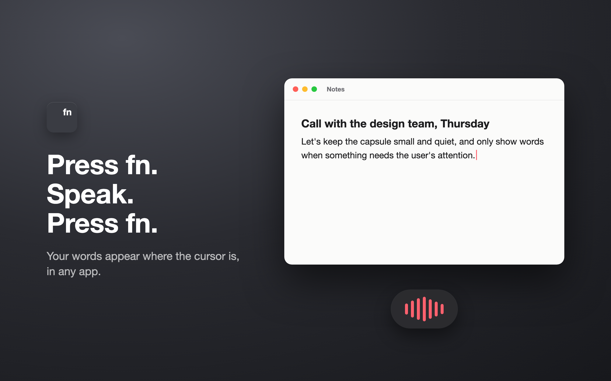

# VoiceFn

Press fn, speak, press fn again. Your words appear where the cursor is, in any app on your Mac.



- **On device.** Speech is recognized locally with [WhisperKit](https://github.com/argmaxinc/WhisperKit)
  (Whisper large-v3 turbo). It works offline and nothing leaves the Mac.
- **Or your own cloud model.** Connect your [OpenRouter](https://openrouter.ai) account and pick a model;
  audio then goes straight from your Mac to OpenRouter, with your key.
- **Any app.** VoiceFn types into whatever is in front: mail, chat, notes, a code editor, a browser.
- **Your key.** fn by default; right Option or any shortcut if you prefer.
- **History.** Dictations stay on your Mac, and a recording that didn't go through can be sent again.
- **Quiet.** A small capsule while you speak and a menu bar icon, nothing else.

English and Russian interface; dozens of dictation languages.

## Install

[Mac App Store](https://apps.apple.com/app/id6831041413) · macOS 14 or later, Apple silicon recommended.

## Build from source

Requires Xcode 26 or later (the app icon is an Icon Composer file).

```sh
./scripts/test.sh                  # unit tests (swift test)
open VoiceMacro.xcodeproj          # run the VoiceMacro scheme
```

The project signs with the author's team. To run your own build, set your team and a bundle ID of your
own in the target's Signing & Capabilities, or from the command line:

```sh
xcodebuild -project VoiceMacro.xcodeproj -scheme VoiceMacro -configuration Release \
  -destination 'generic/platform=macOS' -allowProvisioningUpdates \
  DEVELOPMENT_TEAM=<your team> PRODUCT_BUNDLE_IDENTIFIER=<your.bundle.id> build
```

On first launch VoiceFn asks for the microphone and Accessibility (to type into other apps), and
downloads the Whisper model.

## Privacy

Audio and text never leave the Mac unless you connect OpenRouter. Official builds send anonymous usage
events to [Aptabase](https://aptabase.com) (event names and small counters, never audio or text; Settings can turn this off); builds
from source send nothing unless you set the `VOICEFN_TELEMETRY_KEY` build setting.
Full policy: [voicefn.driftstatic.com/privacy](https://voicefn.driftstatic.com/privacy).

## Layout

| Path | What |
| --- | --- |
| `Sources/VoiceMacro` | the app (SwiftUI + AppKit, sandboxed) |
| `Tests/VoiceMacroTests` | unit tests |
| `server` | the small Go website: home, privacy, support |
| `AppStore` | App Store listing text and screenshot renderer |

Design rules for contributions are in [CLAUDE.md](CLAUDE.md): as little interface as possible.

## License

[MIT](LICENSE). The VoiceFn name and icon are not covered by the license; please use your own for forks
you distribute.
